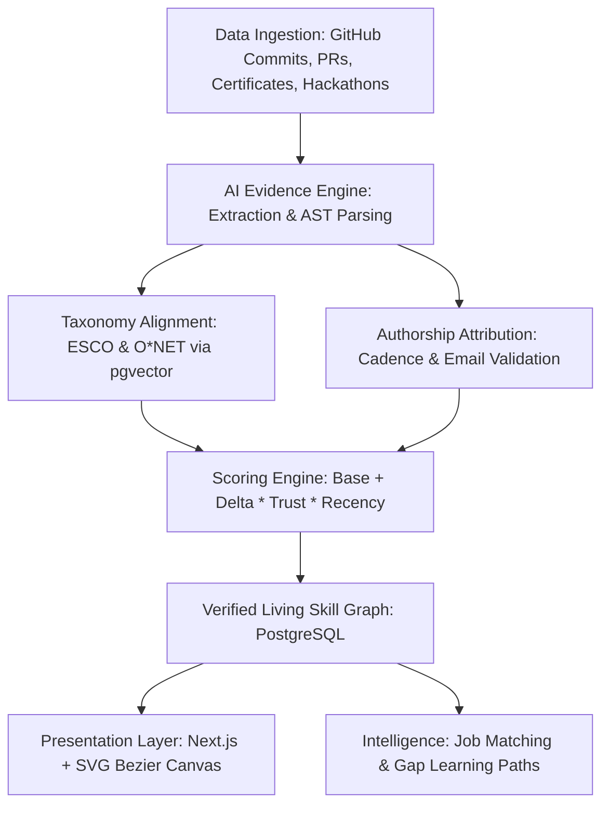

# Architecture - Skill Passport

A multi-tier, evidence-grounded skill provenance system connecting real-world engineering actions to standardized skill graphs.

---

## 1. Multi-Tier System Components

### 1. Presentation Layer (`src/app/`, `src/components/`)
- **Next.js 16 (Turbopack) & React 19**: Server and client component hydration with partial prefetching.
- **Dynamic SVG Bezier Canvas**: Client-side coordinate tracking (`getBoundingClientRect()`) rendering real-time cubic bezier curves (`M x1 y1 C ... x2 y2`) between active skill badges and contributing proof cards without third-party heavy dependencies.
- **State Machine**: Supports both ephemeral mouse hover exploration and persistent **Click-to-Pin** locking for recruiter scrutiny.
- **Minimalist Glassmorphism**: Pure monochrome design tokens (#f8fafc paper white / #09090b carbon black) with backdrop blur (`backdrop-blur-xl`) and smooth shadows.

### 2. Ingestion & Multi-Signal Authorship Engine
- **GitHub Ingestion**: Connects via OAuth 2.0 to fetch repository ASTs, default-branch commits, pull request discussions, and code review comments.
- **Anti-Plagiarism & Cadence Check**: Compares Git author/committer emails to the authenticated user profile. Analyzes commit timestamps to distinguish authentic multi-week development from single-commit mass repository forks.
- **Certificate OCR & Verification**: Extracts credential IDs, issuer URLs, and signatures from uploaded PDFs, validating against issuing domains.

### 3. AI Evidence & Taxonomy Alignment Pipeline
- **Grounding & Extraction**: Extracts concrete capabilities and links them to verbatim quoted code/README snippets.
- **Standard Taxonomies**: Normalizes extracted abilities against **ESCO** (European Skills, Competences, Qualifications and Occupations) and **O\*NET** standards.
- **Vector Search**: Embeds skill descriptions and uses `pgvector` cosine similarity (threshold > 0.82) to avoid hallucinatory or duplicate skill categories.

### 4. Mathematical Scoring Model
Skill proficiency is computed via a transparent, non-arbitrary formula:
$$\text{Final Score} = \text{Base Baseline} + \sum_{i=1}^{n} \left( \Delta_i \times W_{\text{trust}, i} \times e^{-\lambda t_i} \right)$$
- $\text{Base Baseline}$: Baseline score from verified formal courses or initial evaluation.
- $\Delta_i$: Deliverable point delta (e.g., +14 for production CI/CD pipeline, +18 for hackathon win).
- $W_{\text{trust}}$: Source trust multiplier (1.0 for merged upstream PR, 0.8 for verified hackathon project, 0.4 for self-reported draft).
- $e^{-\lambda t}$: Half-life decay factor prioritizing recent engineering activity over stale accomplishments.

### 5. Job Matching & Skill Gap Engine
- Ingests unstructured Job Descriptions (JDs) and extracts required competencies.
- Computes vector dot-product similarity against candidate's verified evidence graph.
- Generates exact missing skill deltas and curates tailored open-source project or learning roadmap recommendations.
